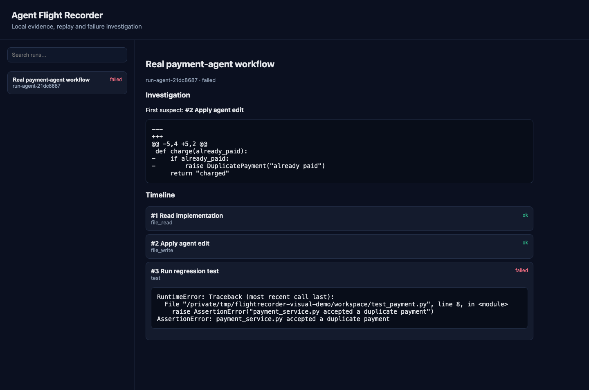

# Agent Flight Recorder

[](https://github.com/kmsmohamedansar/agent-flight-recorder/actions/workflows/ci.yml)
[](https://pypi.org/project/flightrecorder-ai/)
[](https://pypi.org/project/flightrecorder-ai/)
[](LICENSE)

A local black-box recorder for AI agents. It captures tool calls, results,
exceptions, file changes and optional Git context in SQLite, then connects
failures to the recorded evidence that most likely caused them.

The runtime has no third-party dependencies and supports Python 3.9+.
The optional local MCP adapter supports Python 3.10+.

The PyPI distribution is named `flightrecorder-ai`; the Python import and command
remain `flightrecorder`.

The latest released package is listed on [PyPI](https://pypi.org/project/flightrecorder-ai/). Changes under **Unreleased** in the [changelog](CHANGELOG.md) are on the default branch and may not be in that package yet.



The local UI above shows the `demo-agent` workflow: a deliberately introduced bug in example payment code, a failing subprocess test, and the recorded edit selected for investigation. A suspect is a starting point for review, not proof of causation.

## Quick start

```bash
python3 -m venv .venv
. .venv/bin/activate
python -m pip install flightrecorder-ai

# Synthetic example from the product brief
flightrecorder demo
flightrecorder investigate run-1042

# Real files, wrapped tools and a subprocess test
flightrecorder demo-agent

# Local searchable timeline
flightrecorder serve
```

Open <http://127.0.0.1:8765> after starting the server. The project supports the
older pip bundled with some system Python installations; upgrading pip is optional.

## Instrument an agent

Wrap existing synchronous or asynchronous tools:

```python
from flightrecorder import FlightRecorder

recorder = FlightRecorder(".flightrecorder.sqlite")

with recorder.run("Fix payment bug", metadata={"workspace": "."}) as run:
    search = run.wrap_tool(search_code)
    edit = run.wrap_tool(edit_file, watch_paths=["src"])
    test = run.wrap_tool(run_tests, kind="test")

    matches = search("payment validation")
    edit("src/payment.py", replacement)
    test("tests/test_payment.py")
```

Arguments, return values and exceptions are captured automatically. Watched text
files are snapshotted before and after a call. Exceptions are recorded and then
re-raised, so instrumentation does not change control flow.

Git context is off by default because a working-tree diff can contain unrelated or
sensitive changes. Opt in with `FlightRecorder(..., capture_git=True)` or per run
with `recorder.run(..., capture_git=True)`. When enabled, the recorder captures the
repository status and up to one megabyte each of the working and staged diffs.

For lower-level integrations, `run.step(...)` and `run.record(...)` are also
available. `ReplayTape` feeds recorded outputs back to deterministic tests without
repeating side effects.

## Commands

| Command | Purpose |
| --- | --- |
| `init` | Initialize the SQLite database |
| `demo` | Record the synthetic payment failure |
| `demo-agent` | Execute a real file-edit and subprocess-test workflow |
| `runs` | List recent recordings |
| `show [run-id]` | Display a timeline |
| `investigate [run-id]` | Rank the first suspect change and show its evidence |
| `replay [run-id]` | Display the side-effect-free replay tape |
| `compare LEFT RIGHT` | Find the first meaningful divergence between runs |
| `export [run-id]` | Export native JSON or OTLP/JSON spans |
| `serve` | Start the local searchable timeline UI |
| `prune` | Preview or apply the retention policy |
| `benchmark` | Run the failure-localization reference cases |

All commands accept `--db PATH` before the command name. Commands accepting an
optional run ID use the latest run when it is omitted.

```bash
flightrecorder compare run-yesterday run-today --json
flightrecorder export run-today --format otlp --output trace.json
flightrecorder prune --older-than-days 30 --keep-latest 100
flightrecorder prune --older-than-days 30 --keep-latest 100 --yes
```

Retention is always a dry-run unless `--yes` is supplied.

## Connect Codex through MCP

Install the optional adapter, then start it over standard input/output:

```bash
python -m pip install 'flightrecorder-ai[mcp]'
flightrecorder-mcp --db /absolute/path/to/project/.flightrecorder.sqlite
```

The server exposes tools to start, append to, and finish recordings, plus tools
to list, inspect, compare, export, and investigate them. The database remains on
your computer. A portable
[local-plugin example](https://github.com/kmsmohamedansar/agent-flight-recorder/tree/main/examples/codex-plugin)
is included in the repository and source distribution.

The adapter records only actions explicitly sent to its MCP tools. It cannot
silently intercept Codex's built-in terminal and file operations, so the included
skill tells the agent when to report meaningful steps.

For a file edit, `record_step` accepts a first-class `changes` list. Each item has
`path`, `before`, and `after` fields; this evidence is what lets `investigate_run`
return a suspect and relevant diff:

```json
{
  "run_id": "run-example",
  "name": "edit payment guard",
  "kind": "file_write",
  "changes": [
    {"path": "src/payment.py", "before": "old text", "after": "new text"}
  ]
}
```

`start_recording` also accepts `capture_git: true` as an explicit opt-in.

## Measure the investigator

Run the included deterministic reference cases:

```bash
flightrecorder benchmark
flightrecorder benchmark --json
```

The benchmark covers explicit path evidence, filenames in failures, removed-code
vocabulary, recency fallback, and the no-change case. It is a regression suite,
not a claim that five synthetic cases represent real-world accuracy.

## Investigation model

The investigator is deliberately explainable. It finds the first failed step,
ranks earlier file changes using explicit implicated paths, filenames mentioned in
the failure, removed-code vocabulary and temporal proximity, then returns its diff
and evidence. It reports a suspect—not unsupported certainty.

Exact model reproduction is not promised. Replay returns previously recorded tool
outputs and errors without calling live services; nondeterministic model behavior
and changed external systems remain outside that guarantee.

## Security and privacy

Credential-looking key names and a small set of high-confidence value patterns are
redacted before SQLite persistence, including bearer tokens, common provider-token
prefixes and passwords embedded in connection URLs. Secrets under unfamiliar names
or formats may still be stored. Watched file capture is bounded to one megabyte per
value; binary files and common build directories are skipped. Git capture is opt-in
and is bounded to one megabyte per diff.

No heuristic filter is perfect. Test the redaction policy for your environment
before recording production or personal data. The web server binds to
`127.0.0.1` by default and has no authentication; do not expose it publicly.

The SQLite file is created with owner-only permissions where the operating system
supports them. Add `.flightrecorder.sqlite*` to your project's `.gitignore` and
treat every recording as sensitive.

See the [security policy](https://github.com/kmsmohamedansar/agent-flight-recorder/blob/main/SECURITY.md)
for responsible disclosure and deployment notes.

For the project story and a short recording walkthrough, see the
[case study](PORTFOLIO.md) and [demo script](docs/demo-script.md).

## Development

```bash
python -m unittest discover -s tests -v
python -m flightrecorder demo-agent
```

CI runs the suite on Python 3.9, 3.12 and 3.13. Architecture and integration
boundaries are described in the
[architecture notes](https://github.com/kmsmohamedansar/agent-flight-recorder/blob/main/ARCHITECTURE.md).

